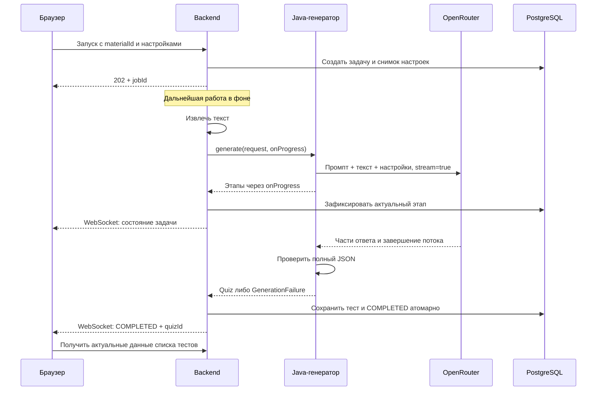

# Генерация теста: контракт и статусы — предложение для согласования

Дата: 01.11.2026. Для задачи «[Analyst + BE] Решить и описать как показывать статус готовности теста».
Это проект решения, НЕ утверждение согласования с командой и НЕ реализация API/WebSocket.
02.11 доступ восстановлен: обязательный аудит получил 90 задач live API, git fetch прошёл.
Основа: предоставленные и сверенные AC/DoD; ветка feature/tpivt6_26-64-ml-generator
обновлена на dev 45300ec. Согласование документа участниками ещё не подтверждено.

## 1. Два разных взаимодействия

1. BE → ML: обычный вызов Java-метода `QuizGenerator.generate(request, onProgress)`
   в фоновом обработчике. ML → OpenRouter: HTTP streaming, уже реализован в компоненте.
2. BE → FE: предлагаем WebSocket для событий состояния; HTTP GET для чтения текущего
   состояния и восстановления после разрыва. Реализация и согласование — BE/FE/Analyst.



| Вариант | Где применим | Решение для MVP |
|---|---|---|
| Kafka | Сообщения между отдельными сервисами; сама не показывает браузеру прогресс | Не вводим для Java-модуля в одном процессе |
| WebSocket | Доставка событий от BE браузеру; требуется авторизация и переподключение | Предлагаем как основной канал FE |
| Периодический HTTP GET | Простое чтение статуса, больше запросов и задержка до интервала | Резерв при недоступном WebSocket, например раз в 3 секунды |
| Callback Java | Передача этапов между ML и BE внутри одного процесса | Уже реализован; не требует сети/брокера |

Streaming OpenRouter и WebSocket браузера независимы. Поток токенов не отправляется
на FE. SSE-формат потока OpenRouter не обязывает использовать SSE в интерфейсе.

## 2. Идентификаторы и состояния

jobId создаёт BE; его строка передаётся в ML как requestId. materialId — UUID материала,
для ML передаётся строкой. Одна задача — один материал и снимок выбранных параметров.
Внешние состояния сохраняем как в текущем OpenAPI: QUEUED, RUNNING, COMPLETED, FAILED.
Не вводим конкурирующее имя SUCCEEDED в публичный контракт без необходимости.

QUEUED → RUNNING → COMPLETED либо FAILED. QUEUED также может перейти в FAILED при
таймауте очереди. Терминальное состояние не откатывается из-за позднего ML-события.
Внутри RUNNING: подготовка → ожидание/ответ модели → проверка → сохранение.

| Источник | Событие ML | Отображение |
|---|---|---|
| BE | Извлечение файла | Подготавливаем материал |
| ML | PREPARING_PROMPT | Готовим запрос |
| ML | WAITING_FOR_MODEL | Ожидаем модель |
| ML | RECEIVING_RESPONSE | Получаем ответ модели |
| ML | VALIDATING | Проверяем тест |
| ML | VALIDATED | ML закончен; BE должен сохранить тест |
| BE | Сохранение | Сохраняем тест |
| BE | COMPLETED | Тест готов, есть сохранённый quizId |
| ML/BE | FAILED | Безопасная причина ошибки и возможность повторить |

WAITING_FOR_MODEL — перед сетевым вызовом; RECEIVING_RESPONSE — при первом непустом
content ответа. Reasoning/keepalive не являются сгенерированным вопросом.
Этапы могут быть короткими или долго не меняться. Отсутствие новых этапов не равно
зависанию. Отображаются индикатор и прошедшее время; проценты не вычисляются из токенов.

В текущем OpenAPI progress обязателен и имеет целочисленный тип — это противоречит
отсутствию реального процента. Предложение: progress допускает null/отсутствие;
до завершения он null, после COMPLETED допустимо 100. Добавить SAVING в stage;
для детализации ожидания/получения согласовать отдельный detailStage либо расширение enum.
Эти изменения только описаны здесь; backend-api.yaml не изменён.

## 3. Вход и результат BE–ML

Вход: requestId, materialId, непустой извлечённый text до 60000 символов,
questionCount 5/10, difficulty easy/medium/hard, один questionType:
single_choice/multiple_choice/true_false. Файлы и пути ML не принимает.
Ограничение символов — защита нагрузки, не точный токенизатор.

Метод возвращает Quiz/M1 v2 либо бросает GenerationFailure с безопасным кодом.
M1 v2 выбран PO 02.11.2026 (ml-output-m1-v2.md); подключение BE/FE ещё требует проверки.
Модельная оболочка requestId/status не является готовностью пользовательской задачи.
BE использует собственный jobId и проверенный результат, а не доверяет статусу модели.

ML-коды: INVALID_INPUT, NOT_CONFIGURED, RATE_LIMITED, MODEL_UNAVAILABLE, MODEL_TIMEOUT,
INVALID_MODEL_OUTPUT, INSUFFICIENT_MATERIAL, CANCELLED. Ошибки извлечения/очереди/БД
определяет BE. Наружу — свой code/message, без ключа, лекции, сырого ответа провайдера.

Текущий GenerateQuizRequest OpenAPI допускает несколько questionTypes, темы и
персонализацию. Для TY5 нужно согласовать ровно один тип, допустимые настройки и
отсутствующие в MVP опции. Не передавать неподдерживаемые параметры и не игнорировать их молча.

## 4. Доставка, готовность, повтор

- BE хранит задачу в БД, WebSocket доставляет уведомления. Источник истины — БД.
- Извлечение и вызов модели выполняются вне долгой SQL-транзакции. Исполнитель
  ограничен по числу одновременных генераций (стартовое предложение: одна).
- ML callback содержит requestId, stage, sequence. sequence возрастает только внутри
  одного вызова. BE назначает внешнюю монотонную version задачи; не использует ML sequence
  как глобальную версию после перезапуска/повтора.
- BE быстро фиксирует callback/передаёт его в очередь доставки. Не держать callback
  заблокированным на записи в сокет. Исключение слушателя изолировано ML;
  работоспособность доставки и журналирование ошибок — ответственность BE.
- COMPLETED устанавливается только в транзакции успешного сохранения теста. При ошибке
  записи — FAILED, а не «готово». Уникальная связь quiz с jobId исключает вторую запись.
- Повтор POST после потери ответа с тем же idempotency key возвращает ту же задачу.
  Явная кнопка «Повторить» после FAILED создаёт новый jobId и новый idempotency key.
  Их имена/место в HTTP-контракте согласовать; сейчас они не реализованы генератором.
- Повторный callback/результат не создаёт второй тест; запоздалые события после
  терминального состояния игнорируются. Для нескольких попыток внутри одной задачи
  потребуется отдельный attemptId; сейчас автоматических повторов ML нет.
- Разрыв WebSocket не запускает модель заново. FE переподключается и читает HTTP-снимок;
  более старая version не затирает новую. Уведомление не содержит правильных ответов.
- Уход/возврат к настройкам не отменяет задачу. FE сохраняет jobId для восстановления.
  Явная отмена не входит в это решение. Несохранённый текст задания не хранить в браузере.
- После рестарта BE незавершённая задача восстанавливается по принятой политике:
  не запускать неизвестно завершившийся внешний запрос автоматически. Для MVP предлагаем
  FAILED/GENERATION_INTERRUPTED и ручной повтор. Дубли записей всё равно запрещены.

## 5. Время ожидания — предлагаемые значения для BE-согласования

В ML уже настроены connect timeout 15 с и таймаут отдельного обращения 90 с и всего generate 240 с (через окружение).
Для остальных частей предложено: очередь 120 с, извлечение 60 с, запись 30 с,
предельный срок задачи от принятия 480 с. Первое достигнутое ограничение завершает
задачу ошибкой; поздний результат не меняет терминальный статус.
Это не обещание производительности и не реализованные таймауты BE: подтвердить после
проверки его обработчиков. Клиентский таймер не назначает FAILED самостоятельно.
При 429 нет автоматического платного fallback и бесконечных повторов.

## 6. Примеры внешних состояний (предложение расширения OpenAPI)

HTTP запуск: POST /api/quizzes → 202 + GenerationJob. HTTP чтение:
GET /api/generation-jobs/{jobId} (пути уже есть в описании, runtime не подтверждён).
WebSocket endpoint, аутентификацию и подписку на jobId уточняют BE/FE; доступ только владельцу,
проверка прав и при подписке, и при HTTP чтении. Истечение сессии не останавливает ML;
получение статуса требует повторной авторизации.

Событие ожидания (фрагмент общего снимка задачи):
```json
{"id":"e26a2918-2b9f-4650-a886-0f7373ef31f0","status":"RUNNING",
 "stage":"GENERATING","detailStage":"WAITING_FOR_MODEL","progress":null,"version":3}
```
Успех (фрагмент):
```json
{"id":"e26a2918-2b9f-4650-a886-0f7373ef31f0","status":"COMPLETED",
 "quizId":"6cd017a4-6d27-41c5-ad53-da96dd6c0d97","progress":100,"version":8}
```
Ошибка (фрагмент):
```json
{"id":"e26a2918-2b9f-4650-a886-0f7373ef31f0","status":"FAILED","progress":null,
 "error":{"code":"MODEL_TIMEOUT","message":"Модель не ответила вовремя. Попробуйте позже."},"version":6}
```
Для полноценного GenerationJob также нужны существующие materialId/kind/createdAt/updatedAt.
version/detailStage/nullable progress — предложенные поля, не текущая реализованная схема.

## 7. Поведение пользователя и распределение реализации

Во время ожидания: этап, индикатор, время; без выдуманных процентов и повторного submit
от двойного клика. Другие страницы доступны. После ошибки: причина, возврат к настройкам,
осознанный повтор. После успеха TY5: сообщение «Тест готов» и переход к таблице тестов.
Прохождение, показ правильных ответов и оценка не входят в TY5. Локальный удалённый макет
показывал вопросы/ответы только для отладки ML, его нельзя принимать за UX TY5.

| Существующая задача | Реализует |
|---|---|
| [ML] Создать сервис для генерации теста | Генератор, вызов модели, валидация, callback этапов |
| [BE] Создать API для запуска генерации теста | Проверки доступа, извлечение, задача, фон, вызов ML, статусы, доставка |
| [BE] Создать API для получения параметров генерации тестов | Справочник настроек и проверяемые значения |
| [BE] Создать cRUD для тестов | Единая транзакционная запись, чтение списка, отсутствие дублей |
| [FE] Создать страницу для генерации теста | Запуск, подписка/восстановление, ожидание и навигация |
| [FE] Создать форму, что не удалось сгенерировать тест | Ошибка, возврат, повтор |
| [FE] Создать форму, что тест готов | Успех и переход в таблицу |
| [Testing] Протестировать API для генерации теста | Проверка реального полного обмена и ошибок |
| [Testing] Написать автотесты для генерации теста | Автоматизация интеграционных сценариев |
| [Testing] Написать тест кейсы для генерации теста | Трассировка AC и сценарии |

## 8. Что нужно для закрытия аналитической задачи

Документ и схема подготовлены. Нужно ревью BE/FE/ML/Testing и подтверждение участника,
согласование M1/полей/таймаутов/подписки, перенос принятого решения в требования и ссылка
из карточки. Сейчас документ никому не отправлен, Wiki/карточки не изменены.
Сам документ не требует фиктивных unit-тестов. Рабочая реализация каналов остаётся
в соответствующих задачах; её отсутствие не подменять обещанием «всё уже работает».
Если документ попадёт в репозиторий — приложить PR и ревью; локальный файл не равен публикации.

ML дополнительно сообщает REVIEWING_CONTENT («Проверяем содержание») и REVISING
(«Исправляем тест»). Этапы могут повторяться при одной исправляющей попытке;
sequence при этом продолжает возрастать. Это не проценты и не откат состояния задачи.
